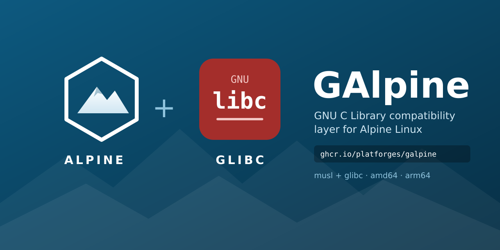

# GAlpine
> [!TIP]
> _GNU C Library compatibility layer for Alpine Linux_

<p align="center">
  
</p>
GAlpine is an Alpine Linux adaptation that allows it to run packages that
depend on dynamic linking with the GNU C Library. This works by installing
`glibc` to the prefix `/usr/glibc` as a special `.apk` package, that is rigged
with an apk trigger modifies the linker configuration giving preference to
`glibc` only when packages are installed to certain directories, allowing
`musl` and `glibc` to work side-by-side.


## Usage
Images are published to the GitHub Container Registry for `linux/amd64` and
`linux/arm64/v8` (the platforms Miniconda supports), tagged by Alpine version:

```sh
docker pull ghcr.io/platforges/galpine:latest
docker pull ghcr.io/platforges/galpine:3.24
docker pull ghcr.io/platforges/galpine:3.23
```

## Building
```sh
make build ALPINE_VERSION=3.24   # build for linux/amd64
make test  ALPINE_VERSION=3.24   # Miniconda + numpy smoke test
make build PLATFORM=linux/arm64  # non-native platforms need QEMU/binfmt
```

glibc is cross-compiled on the build host, so only the packaging stages run
under emulation for non-native platforms.


## Comparison with alternatives

| | GAlpine (this project) | [gcompat](https://git.adelielinux.org/adelie/gcompat) | [dalet-oss/alpine-glibc](https://github.com/dalet-oss/alpine-glibc) |
|---|---|---|---|
| Approach | Real GNU glibc next to musl | Shim that maps glibc symbols onto musl | Real GNU glibc next to musl (based on [sgerrand](https://github.com/sgerrand/alpine-pkg-glibc)) |
| Delivered as | Base image on GHCR | Official Alpine package (`apk add gcompat`) | `.apk` files on GitHub Releases |
| Compatibility | High (Conda, manylinux wheels, …) | Partial: simple binaries only | High |
| Size | Tens of MB | About 100 KB | Tens of MB |
| Install prefix | `/usr/glibc` | n/a (musl) | `/usr/glibc-compat` |
| Build | Single Dockerfile, cross-compiled from GPG-verified GNU sources | Alpine aports | GitHub workflows, artifacts kept in Git LFS |
| Package signing | Throwaway build-time key | Alpine official keys | Published, stable key |
| Smoke test | Miniconda + numpy on every platform | — | — |
| Platforms | `amd64`, `arm64/v8` | All Alpine architectures | `amd64`, `arm64` |

gcompat conflicts with both glibc approaches (they all install
`/lib/ld-linux-*.so.2`), so don't install it in this image.
